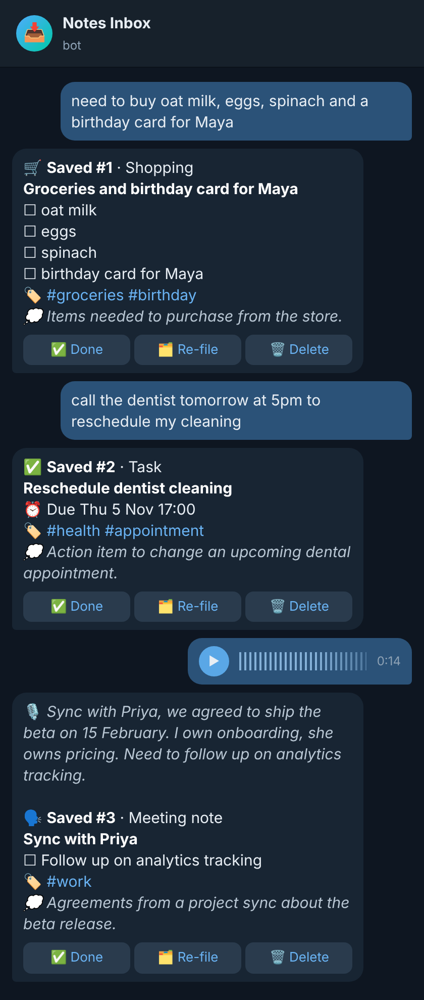
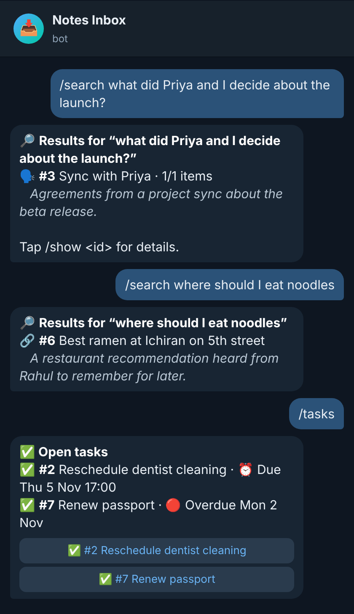
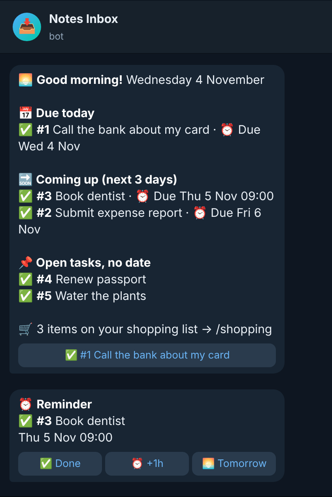
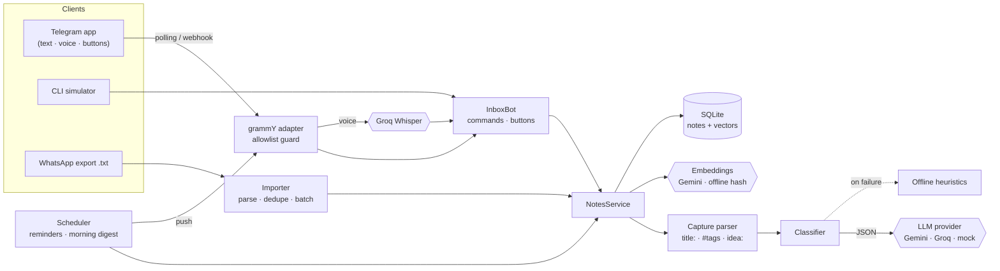
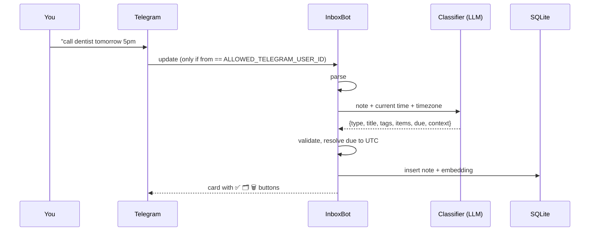

<div align="center">

# 📥 Notes Inbox

**Dump anything into a Telegram chat — AI files it so you can actually find it later.**

A personal bot that replaces the habit of messaging notes to yourself on WhatsApp: tasks, shopping lists, meeting notes, ideas, links, voice memos. It classifies, titles, tags, splits and dates everything, reminds you, and lets you search by *meaning*.


</div>

<p align="center">
  
  &nbsp;
  
  &nbsp;
  
</p>
<p align="center"><sub>Illustrative mockups of real bot output (the text was produced by the actual pipeline; rendered from <code>docs/mockups/chat.html</code>).</sub></p>

## Why

Dumping notes into a self-chat is frictionless to *write* and miserable to *use*: that one shopping list is buried under 3,000 messages, the task you wrote last month never resurfaces, and you can't remember which words you used. Notes Inbox keeps the zero-friction capture and adds the missing part: structure and recall.

## Features

- **Capture anything** — plain text, `Title: content`, `#tags`, `idea:`/`todo:`/`buy:` prefixes, and **voice notes** (transcribed with Groq Whisper).
- **AI filing for every note** — type (`task · shopping · meeting · idea · reference · journal · other`), a clean title, tags, **extracted items** (a shopping list becomes a checklist), **due dates** ("tomorrow at 5pm" → real timestamp in your timezone) and a one-line **"why I saved this"**.
- **Recall** — `/tasks`, `/shopping`, `/ideas`, `/meetings`, `/links`, `/recent`, and **`/search` in natural language** powered by embeddings ("where should I eat noodles?" finds the ramen tip).
- **Inline buttons** — ✅ done, 🗂 re-file as another type, 🗑 delete (with undo), ⏰ snooze.
- **Reminders & morning digest** — timed tasks ping you; every morning you get overdue / today / coming up / open tasks / shopping count.
- **WhatsApp import** — bring your old self-chat export, classified in bulk with original dates preserved, safe to re-run.
- **Private by design** — answers exactly one Telegram user ID (`ALLOWED_TELEGRAM_USER_ID`); everyone else is silently ignored.
- **Never loses a note** — if the AI is down or rate-limited the note is saved by an offline classifier and can be upgraded later with `/reprocess`.
- **Runs without Telegram** — a CLI simulator drives the very same pipeline; no API keys needed (mock mode).
- **Free to run** — Gemini + Groq free tiers, SQLite, and a tiny footprint.

## Example

```text
You: need to buy oat milk, eggs, spinach and a birthday card for Maya
Bot: 🛒 Saved #1 · Shopping
     Groceries and birthday card for Maya
     ☐ oat milk   ☐ eggs   ☐ spinach   ☐ birthday card for Maya
     🏷 #groceries #birthday
     💭 Items needed to purchase from the store.
     [ ✅ Done ] [ 🗂 Re-file ] [ 🗑 Delete ]

You: call the dentist tomorrow at 5pm to reschedule my cleaning
Bot: ✅ Saved #2 · Task — Reschedule dentist cleaning
     ⏰ Due Thu 5 Nov 17:00    🏷 #health #appointment

You: /search where should I eat noodles
Bot: 🔗 #6 Best ramen at Ichiran on 5th street
        A restaurant recommendation heard from Rahul to remember for later.
```

Try it yourself in 30 seconds, no accounts needed: `npm install && npm run simulate`.

## Tech stack

| | |
|---|---|
| Language | Node.js ≥ 20, TypeScript (strict, ESM) |
| Telegram | [grammY](https://grammy.dev) — long polling or webhook |
| AI | Google **Gemini** (classification + embeddings) · **Groq** (Whisper transcription, alt. classifier) behind a small provider interface; plain `fetch`, no SDKs |
| Storage | SQLite (`better-sqlite3`), embeddings stored alongside notes; async `NoteStore` interface for Postgres/libSQL later |
| Quality | vitest (~170 tests incl. a fake Telegram Bot API), ESLint, GitHub Actions CI |
| Deploy | Dockerfile, `render.yaml`, `fly.toml`, systemd notes |

## Architecture



The key idea: **`InboxBot` is transport-neutral** — it takes text/button presses and returns `Reply` objects. Telegram, the CLI, and one day a web or mobile client are thin adapters around the same brain.



## Getting started

```bash
git clone https://github.com/SarthakJain29/Notes-Inbox-app && cd Notes-Inbox-app
npm install
npm run simulate        # try it in your terminal (mock AI, no accounts)
```

To use real AI and Telegram:

```bash
cp .env.example .env    # add GEMINI_API_KEY, GROQ_API_KEY, TELEGRAM_BOT_TOKEN, ALLOWED_TELEGRAM_USER_ID, TIMEZONE
npm run build && npm start
```

Step-by-step BotFather setup, finding your user ID, free hosting options (Render / Fly / Railway / a free VM), webhook vs polling, and every environment variable are in **[developer.md](developer.md)**.

### Commands

| | |
|---|---|
| *(any text / voice note)* | capture & file |
| `/tasks` `/shopping` `/ideas` `/meetings` `/links` `/journal` `/recent` | browse by type |
| `/search <question>` | semantic search |
| `/show <id>` `/done <id>` `/delete <id>` `/type <id> <type>` | act on a note |
| `/digest` | today's digest on demand |
| `/reprocess` `/reindex` `/export` | maintenance: re-run AI on offline-filed notes, rebuild search vectors, JSON export |

### Import your WhatsApp self-chat

```bash
npm run import:whatsapp -- chat.txt --dry-run   # preview the classification
npm run import:whatsapp -- chat.txt             # import (idempotent, keeps original dates)
```

### Develop

```bash
npm run check    # typecheck + lint + tests
npm run dev      # bot with auto-reload
```

## Roadmap

- [x] Capture, AI filing, semantic search, reminders, digest, WhatsApp import, voice notes, CLI simulator
- [ ] Verify live on Telegram + deploy with persistent storage (see `developer.md` → Blockers)
- [ ] JSON restore, scheduled backups
- [ ] Per-item checklist toggling and quantities merging across shopping notes
- [ ] Natural-language filters in search ("ideas tagged work from last month")
- [ ] Weekly review & "resurface forgotten notes"
- [ ] Photos/documents (OCR + vision), forwarded messages, email-in
- [ ] **Multi-user**: the data model and store are already `user_id`-scoped; add onboarding + per-user timezone/digest
- [ ] **Web app and mobile app** (React / React Native or a PWA) reusing `NotesService`/`InboxBot` behind an HTTP API with real auth
- [ ] Postgres/Turso store and a vector index (pgvector / sqlite-vec) for big collections

## License

MIT
